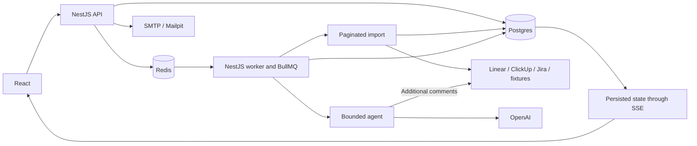

# Architecture

Target design for the complete workflow. S01 now supplies workspaces, schema, authentication, and the protected UI shell; source adapters, queue execution, snapshots/SSE, and review remain later-stage work. Alternatives and dated version research: [D01](../decisions/D01-stack-and-local-runtime.md). Authentication and credentials: [D04](../decisions/D04-auth-and-credentials.md).

## Components



The API authenticates users and accepts commands. The worker executes sync/review independently of the browser tab. Postgres is the source of truth for tasks, runs, results, and refresh-token state. Redis handles the queue, OTP challenges, and rate limits. Access uses JWT cookies under [D04](../decisions/D04-auth-and-credentials.md#limits-and-sessions); no Redis authentication-session store is required. SSE delivers state; it does not store results. Import covers the whole period without a task-count cap; analysis and review process batches and record coverage. [States, idempotency, and recovery](sync-workflow.md).

Docker Compose runs api, worker, postgres, redis, mailpit, and a one-shot migration service. The API and worker share an image with different entrypoints; the API serves the built frontend at localhost:3000 without another reverse proxy. During development, Vite :5173 proxies /api, including SSE. One origin simplifies cookie authentication. `APP_PORT` may override the published Compose port (default 3000); set `APP_ORIGIN` to the matching browser origin. This does not change the internal API port.

APP_ORIGIN identifies the browser-facing origin: http://localhost:3000 for Compose and http://localhost:5173 for the Vite development flow. Route browser API/SSE traffic through the matching origin/proxy and validate the original browser Origin header; rewriting the proxy Host does not replace this check. Use the chosen hostname consistently for host-only cookies.

## Code structure

```text
backend/
  src/
    modules/
      app.module.ts  # HTTP API root module
      worker.module.ts # worker root module
      auth/          # password, OTP, JWT, refresh rotation, CSRF
      connections/   # credential verification and storage
      projects/      # catalog and saved-snapshot pages
      jobs/          # commands, states, SSE, reconciliation
      agent/         # loop, tool dispatcher, validation, budgets
      providers/     # Linear, ClickUp, Jira, fixtures
      reviews/       # saved-snapshot self-review, renderer
    exceptions/      # Nest exception filters and safe HTTP error mapping
    shared/
      config/        # ConfigModule, typed ConfigService, Zod environment validation
      infrastructure/ # InfrastructureModule registers shared providers
      database/      # DI-managed Prisma client and low-level factory
      redis/         # DI-managed Redis connection
      mail/          # DI-managed SMTP transport
      clock/         # overridable application clock
    app.ts           # API construction and runtime boundaries
    main.ts          # HTTP API
    worker.ts        # application context and BullMQ worker
  prisma/            # schema and migrations
  fixtures/          # synthetic snapshots and expected invariants
frontend/
  components.json    # shadcn/ui configuration and aliases
  src/
    App/index.tsx    # router composition; local components live under App/components
    pages/           # route pages; page-only components live under each page
    components/ui/   # basic UI, including adapted shadcn/ui, as Name/index.tsx
    components/templates/ # shared composed blocks such as OTP and AppShell
    auth/            # browser session and account coordination
    lib/             # shared frontend infrastructure/utilities
    styles/globals.css # Tailwind entry and semantic theme tokens
contracts/
  src/               # shared HTTP/SSE schemas and inferred TypeScript types
docs/
```

npm workspaces, ESM, strict TS. The root package.json lists three workspaces: backend, frontend, contracts; each has its own package.json, with one lockfile at the root. Contracts builds to JS/d.ts before backend and frontend. The API and worker are two entrypoints in the same backend package. The Docker build context is the repository root so all three packages are available.

Each workspace uses a private `@app/` alias for its own `src/`, following the [backend](../codestyle/backend.md#imports), [frontend](../codestyle/frontend.md#imports), and [contracts](../codestyle/contracts.md#files-and-exports) import rules. Backend/contracts builds resolve aliases to ordinary relative `.js` specifiers through `tsc-alias`, including contracts declarations; API/worker production entrypoints still run directly in Node ESM without an alias loader. Development `tsx` resolves backend's alias, and Vite/shadcn use frontend's alias. Vitest unit projects keep backend, frontend, and contracts aliases separate; the integration configuration uses backend's alias. Public workspace boundaries continue using `@self-review/contracts`, whose exports do not expose a private `@app/` dependency.

Detailed file placement, component directories, module-category folders, naming, and formatting are owned by the code-style guides: [common](../codestyle/common.md), [frontend](../codestyle/frontend.md), [backend](../codestyle/backend.md), and [contracts](../codestyle/contracts.md). This section retains workspace responsibilities and dependency boundaries.

Contracts is an internal library, not a separate service or Nest module. It contains only browser-safe HTTP request/response and SSE schemas, including the public report structure. SDKs, Prisma, configuration, prompts, and internal tool/provider schemas stay in backend. Package publication and a separate container are unnecessary.

A shared package is not required for the application to work: the alternative is server-side Zod schemas and separate frontend types. A small contracts package is chosen so the API and UI share one definition of public states and data; the cost is a package.json and an extra build step. Do not turn it into a library for all business logic.

Do not add a second monorepo tool on top of npm. The provider interface normalizes discovery/list/details/comments, while ModelClient supports scripted offline execution. Only the backend makes direct external calls; the worker does not receive secrets in job payloads.

## Backend dependency injection

Nest owns the backend application dependency graph. AppModule, AuthModule, ConfigModule, InfrastructureModule, and WorkerModule use static module metadata. ConfigModule lives beside ConfigService in `shared/config/`; InfrastructureModule lives in `shared/infrastructure/`. Root and feature modules remain under `modules/`. AuthModule imports ConfigModule/InfrastructureModule and registers AuthService, ChallengesService, CryptoService, PasswordHashService, and AuthController. The API bootstrap creates AppModule and configures HTTP middleware/static routing; it does not create application services or pass an already-constructed AuthService through `register()`. The global SafeErrorsFilter is registered through `APP_FILTER` in AppModule. Expected HTTP failures use the standard Nest exception classes with explicit public `{code,message,retryable}` payloads. The filter validates these payloads against the contracts error schema and adds requestId; unstructured HttpExceptions keep their status with a generic HTTP_ERROR body, while unknown infrastructure failures retain the safe retryable 503 response. Raw error bodies/causes are not forwarded. A custom Failure HTTP error class is not used. WorkerModule imports the same infrastructure module and owns its foundation-readiness provider.

The custom ConfigService in `backend/src/shared/config/config.service.ts` reads and validates the existing environment once per application context, using the existing Zod schema and independent-secret checks in `config.schema.ts`. It exposes immutable validated values and a typed getter. Node's existing `--env-file`/Compose environment handling remains the source of environment loading; no additional configuration package or alternate validation policy is introduced.

InfrastructureModule exports injectable DatabaseService, RedisService, MailService, and ClockService. Database and Redis connections initialize through `onModuleInit` before application readiness. Mail transport is owned by MailService. Each process/context closes its owned database, Redis, and mail resources through `onApplicationShutdown`; explicit `app.close()` and the entrypoints' enabled shutdown hooks use the same lifecycle. PasswordHashService prepares its dummy Argon2 hash in `onModuleInit` and owns Argon2 operations with the existing process-local concurrency limit. CryptoService injects ConfigService/ClockService and owns access-JWT/CSRF operations plus the auth module’s token, SHA-256, HMAC, and comparison helpers. AuthService coordinates authentication through these providers; callers do not pass secrets or signing/verification timestamps to CryptoService. The foundation worker publishes its readiness file only after initialization and successful database/Redis probes, and removes it on shutdown. This does not add queue processors before S02.

HTTP routes, cookie/CSRF rules, token lifetimes, and public payloads remain governed by their existing specifications. Production initialization has no test-specific dependency options. Integration setup imports the same AppModule through Nest's testing module and overrides configuration, mail, clock, or storage providers as needed; child failure-case contexts borrow existing storage clients without taking ownership of their shutdown. Controlled-clock and transport substitutions remain labeled test boundaries.

## Frontend routing

React Router runs in Declarative mode with BrowserRouter, explicit routes, and a protected application layout. The router selects screens; TanStack Query owns server data. Project/snapshot identifiers in navigation select saved resources, and backend ownership checks apply to every resulting API request.

Nest serves index.html for client-page navigation and deep-link reloads. The SPA fallback excludes /api routes, SSE, and asset requests so API errors and missing assets do not become successful HTML responses. A saved project link can be reopened using cookie authentication and persisted database state. S01 verifies the fallback alongside static serving.

## Frontend UI

shadcn/ui provides the component starting points, Tailwind CSS supplies utility styles through its Vite integration, and a global stylesheet defines semantic theme variables. Initialize shadcn/ui in the existing frontend workspace; component source stays in frontend/src/components/ui, with frontend/components.json and aliases configured for the client SPA.

AppShell composes the shadcn Sidebar provider/navigation/inset, including its Sheet-based mobile presentation; AppSidebar owns only application links and account actions. AuthPanel composes Card for shared authentication/recovery pages, and forms/statuses reuse Label/Input/Button/Alert. Component layout and responsive styles use Tailwind classes; globals.css owns tokens, semantic mappings, and base rules under the [frontend styling guide](../codestyle/frontend.md#tailwind-and-component-styling). Mobile navigation uses the Sidebar's md/768px breakpoint; close/focus/overflow behavior must be manually verified at an actual narrow viewport rather than inferred from a build.

Screens and interactions follow [UX.md](../design/UX.md); appearance and theme integration use all required [frontend design inputs](../stages/README.md#frontend-design-inputs). Add components needed by the planned screens and commit their source and dependency lockfile. S01 records the CLI version, preset/primitive family, component origins, and material reference adaptations so later additions use a consistent setup. Source updates require review alongside package updates; composed screens still need the accessibility checks defined in [UX.md](../design/UX.md#shared-states-and-accessibility).

## Frontend data flow

TanStack Query manages server data in memory, fetch performs HTTP requests, and native EventSource receives SSE job state. Form inputs, task selection, and dialog state use local React state. Public HTTP/SSE payloads are validated against contracts.

Owned-resource query keys include the verified application user ID and the relevant project, sync/run, and pagination parameters. Queries read persisted API data. SSE state is deduplicated by runId/version; terminal events invalidate the affected project, snapshot/task, and report queries so active views reload saved results. Refreshing a query never starts an agent. Job-start mutations require an explicit action, have automatic TanStack Query retries disabled, and follow the [idempotency rules](sync-workflow.md#idempotency-and-retries).

On a protected request's ACCESS_EXPIRED/ACCESS_MISSING response, coordinate one recovery operation rather than independently refreshing every query. Under a same-origin Web Lock, first recheck auth/me without invoking recovery recursively: another tab may already have renewed cookies. Otherwise obtain the CSRF bootstrap and call auth/refresh once, then verify auth/me. The same lock serializes refresh, OTP verification, and logout across tabs; BroadcastChannel signals account changes without carrying tokens. Bound lock waits and stop recovery if the initiating authentication context changed. If Web Locks are unavailable, show a supported-browser requirement rather than silently enabling unsafe concurrent refresh. S01 verifies availability on the documented localhost browser setup.

Replay the protected request at most once only if recovery confirms the same user and AuthSession. For a job-start POST, preserve the exact body and idempotencyKey; the initial authentication 401 must occur before business effects. All business mutations, including replays, hold the same origin-wide authentication lock from the identity recheck through the HTTP response so another tab cannot switch cookies between the check and submission. Recovery reuses an already-held lock without nesting lock acquisition. Do not automatically replay after network errors/5xx or retry the refresh POST. Refresh endpoints never enter their own recovery handler. A definitive refresh 401 ends local authentication; an infrastructure failure shows a retryable error instead of falsely claiming expiry. An EventSource error uses this recovery path before reconnecting; event-stream loss never restarts a job.

On logout, absolute authentication expiry, refresh revocation, or user/session change, cancel pending reads, close event streams, and clear query/auth state before displaying another account. HTTP reads consume cancellation signals, and late responses or queued replays cannot repopulate another user's view. Recheck the identity after acquiring the shared lock and before replay; never send an old account's queued mutation using another account's cookies. The query cache is not persisted to browser storage. Credential lifetimes, CSRF bootstrap, and revocation limits remain defined in [D04](../decisions/D04-auth-and-credentials.md#refresh-logout-and-csrf). [Web Locks](https://developer.mozilla.org/en-US/docs/Web/API/Web_Locks_API) provides same-origin cross-tab coordination; it does not replace database concurrency checks.

## Data

This is the authoritative entity specification; the S01 Prisma schema and initial SQL migration implement these storage foundations. The MVP uses one Postgres SQL schema, public, without separate auth/integrations/agent schemas. Public is a SQL namespace, not permission for public data access. The backend accesses the database, and the application checks user permissions.

| Prisma model | Postgres table | Fields and constraints |
| --- | --- | --- |
| User | public.users | UUID, unique normalized email, passwordHash, emailVerifiedAt; passwords are stored only as hashes |
| AuthSession | public.auth_sessions | UUID referenced by access JWT sid and RefreshToken.sessionId; userId FK, createdAt, absolute expiresAt, revokedAt; one record per completed OTP login, representing one refresh-token family rather than a Redis session |
| RefreshToken | public.refresh_tokens | UUID, sessionId FK, unique tokenHash, createdAt, expiresAt, consumedAt, replacedById linking the successor; indexed sessionId/expiry, successor cannot belong to another session; no plaintext token |
| Connection | public.connections | ownerId, provider, mode, displayName, encryptedCredentials, credentialVersion, sourceUserId, sourceUserName, optional verified sourceBaseUrl for constructing Jira links, status; one live connection per provider per user |
| SourceProject | public.source_projects | connectionId, externalId, resourceType, name, breadcrumb; unique(connectionId, externalId) |
| JobRun | public.job_runs | ownerId, projectId, type sync/review, trigger manual/automatic, immutable selection/filters, subjectSourceUserId, baseSyncRunId for selected resync, sourceSyncRunId for review, generateReview/currentReviewReportId for sync, idempotencyKey, requestFingerprint, state/stage/version, counts, completeness flags, heartbeatAt/unitDeadlineAt, timestamps, error, usage/trace; unique(ownerId,type,idempotencyKey) |
| TaskSnapshot | public.task_snapshots | syncRunId, externalId, identifier, title, normalized description, state, assignees[], source timestamps, retrievedAt, safe URL, detail/refresh status, comment-read metadata, copiedFromSnapshotId; unique(syncRunId,externalId) |
| CommentSnapshot | public.comment_snapshots | taskSnapshotId, externalId, normalized body, author/timestamp, retrievedAt; unique(taskSnapshotId,externalId) |
| AnalysisBatch | public.analysis_batches | runId, phase, level, ordinal, input snapshot/child IDs, state, coverage, trace/usage, and validated output; unique(runId,phase,level,ordinal) |
| SyncAnalysis | public.sync_analyses | Unique syncRunId, validated findings JSON and limitations; AI analysis does not replace source tasks |
| ReviewReport | public.review_reports | Unique reviewRunId, sourceSyncRunId, subjectSourceUserId, validated ReportDraft and Markdown, source references |
| ModelAttempt | public.model_attempts | runId, batchId referencing the AI AnalysisBatch unit, attemptNo monotonically increasing within the run, status, provider response ID, known usage/unknown flag; unique(runId,attemptNo) |

Public resource IDs refer to internal records. TaskSnapshot.id is the UUID accepted in selected-resync taskIds; externalId is the provider's opaque ID, and identifier is a human-readable label that may differ from it. Tool ID mappings are defined in [agent workflow](agent-workflow.md#tools).

JobRun.version is the revision counter used for persisted state/SSE updates. A report version is a distinct ReviewReport record identified by its own ID and reviewRunId; it is not JobRun.version. Connection.credentialVersion tracks credential replacement. ModelAttempt.attemptNo is unique across a run; per-unit limits count attempts with the same batchId rather than resetting that number.

Relations, IDs, timestamps, and states use separate columns with FK/unique constraints. Structured findings/ReportDraft, AnalysisBatch input IDs/outputs, assignees, filters/counts, usage/trace, and breadcrumbs use JSONB where a separate entity is unnecessary. Markdown and normalized description/comment use text. Secret credential payloads are stored only in authenticated encrypted envelopes, not plaintext JSONB. Prisma migrations define exact snake_case column mappings.

A Postgres partial unique index on (ownerId,projectId) for queued/running JobRun rows enforces the shared sync/review activity slot. S01 includes the required SQL migration rather than relying only on UI disabling or a non-atomic existence check. Idempotency fingerprints and automatic-child transitions follow the [sync workflow](sync-workflow.md#idempotency-and-retries).

AuthSession and RefreshToken reference User through ownership/FKs; deleting a user cascades this authentication state. Refresh rotation, logout, and replay revocation lock the same AuthSession row and update the token chain transactionally. A consumed token has at most one successor. Retain consumed rows until the session's absolute expiry for replay detection, then clean up the session and its chain together. Ordinary JWT validation does not query these rows for immediate revocation; lifecycle semantics are owned by [D04](../decisions/D04-auth-and-credentials.md#refresh-logout-and-csrf).

TaskSnapshot also records comment-read state, read timestamp, truncation, and a safe error code. This metadata distinguishes not read, a successful empty read, capped results, and a failed read even when there are no CommentSnapshot rows. Copied tasks retain this metadata and its original timestamps. Successfully refreshed tasks start with comments not read until this run requests them; a stale retained copy preserves old metadata without presenting it as a new read.

JobRun type=review stores sourceSyncRunId pointing to a JobRun with type=sync; ReviewReport stores the same sourceSyncRunId and its producing reviewRunId. Trigger defaults to manual for client commands; the backend sets automatic only for a review created after successful sync. A Postgres partial unique index on sourceSyncRunId where type=review and trigger=automatic allows at most one automatic review per snapshot across all states, while manual report versions remain unrestricted by that index. A database CHECK limits trigger to manual or automatic review; the existing review source constraint requires a non-null source. Automatic review is found through sourceSyncRunId/type/trigger within the existing reviewRuns relation. Sync captures generateReview/selection and the token owner's subjectSourceUserId; sourceSyncRun.currentReviewReportId points to the latest valid report for that revision. Completed snapshot data and terminal states are immutable; the current-review metadata pointer changes after successful regeneration. A repeated sync creates new rows. Analysis and reports reference specific Task/CommentSnapshot records, not an updatable latest task. Large raw provider responses are not stored in full: only necessary normalized fields and provenance are retained.

Check ownership through relations on every read/write, including SSE and export; knowing a UUID does not grant access. There is no global catalog of other users' connections or tasks. Connection deletion is blocked during active jobs in the MVP. After confirmation, it cascades through local credentials, snapshots, and reports; it does not revoke the shared personal token at the provider.

## Other storage locations

| Location | Contents and lifecycle |
| --- | --- |
| Redis, auth challenges | Pending signup/login: email/userId, passwordHash only for pending signup, OTP HMAC, browser binding, and attempts; TTL and atomic consumption follow D04 |
| Redis, rate limits | Temporary send/failure counters, without plaintext passwords or OTP |
| Redis, BullMQ | Queue and internal execution state; the application payload contains only runId. Persistent business status remains in job_runs |
| Worker memory | Model history, tool call IDs, seen excerpts, and memoization for the current unit only, without accumulating every project description; source snapshots and known results are saved separately |
| Browser cookies | Access JWT and opaque refresh token in separate HttpOnly cookies, plus the pre-auth browser binding until OTP verification; token values are unavailable to frontend JavaScript |
| Frontend memory | Display data, filters, authentication expiry metadata, and the CSRF token; no access/refresh tokens or tracker credentials |
| Mailpit / email inbox | OTP messages for the user to read; the email contains the code itself but is not the application's authentication store |
| Local .env | AUTH_SECRET, JWT_SECRET, TOKEN_ENCRYPTION_KEY, OpenAI/SMTP credentials; backend/runtime only, outside Git and Docker image layers |
| Docker volumes | Persistent Postgres files and Redis AOF; stopping containers without deleting volumes preserves them |

There is no separate Sources SQL table in the MVP: sourceId refers to TaskSnapshot metadata/description or a CommentSnapshot. Claims store sourceId and quote inside validated analysis/report JSON. The coverage envelope contains counters/flags and batch references. Full task lists and traces are paginated; report sources contain cited records, not every project description. Model Sources are built from these records, and excerpt exposure is checked during execution.

The Prisma schema in backend/prisma describes persistent tables and relations. Zod schemas in contracts/src describe public HTTP/SSE requests and responses, not storage. Internal tool/provider/AI Zod schemas stay in backend and validate execution boundaries; schema files themselves contain neither user data nor secret values.

## API

Zod is the source of input/output schemas and TS types. Model and external-response schemas are validated separately. Unknown input fields are rejected; Swagger UI is optional. All business endpoints require completed OTP authentication; unsafe methods also require CSRF/Origin checks.

| Endpoint | Purpose |
| --- | --- |
| POST /api/auth/signup | Email/password → pending signup challenge and OTP email, without a full session |
| POST /api/auth/login | Verify email/password → pending login challenge |
| POST /api/auth/verify-otp | challengeId + code → verification, AuthSession/initial refresh hash, access/refresh cookies, safe user/expiry metadata; no token values in JSON |
| POST /api/auth/resend-otp | Bounded resend; the previous code becomes invalid |
| GET /api/auth/me | Valid access JWT → current user, sid, access/session expiry metadata, and CSRF token; ACCESS_EXPIRED/ACCESS_MISSING when appropriate |
| GET /api/auth/csrf | CSRF bootstrap through valid access or an active unconsumed refresh cookie; read-only, without token issuance or rotation |
| POST /api/auth/refresh | Refresh cookie + Origin/CSRF → transactional rotation and new token cookies; works after access expiry, no token values in JSON |
| POST /api/auth/logout | Origin/CSRF → revoke the current refresh chain and clear both cookies; idempotent, without claiming immediate JWT revocation |
| GET/POST /api/connections | Own connections only; POST accepts write-only credentials and verifies access |
| PUT/DELETE /api/connections/:id | Replace credentials / confirmed deletion of local data |
| GET /api/connections/:id/projects?cursor=... | Paginate all accessible projects for this connection |
| GET /api/projects/:id | Owned project metadata, connection/token-owner display, and saved/current-run references for direct navigation; no credentials |
| POST /api/projects/:id/syncs | {selection,generateReview?:boolean,idempotencyKey} → 202 {runId,state,eventsUrl}; period or tasks selection as defined in sync workflow |
| GET /api/jobs/:id; GET /api/jobs/:id/events | Persisted state, import/analysis flags, and authenticated SSE |
| GET /api/jobs/:id/batches; GET /api/jobs/:id/trace | Paginated units/trace for the owner only; no huge response containing the entire project |
| GET /api/projects/:id/syncs | Own snapshot history and an unfinished job |
| GET /api/projects/:id/tasks?syncRunId=... | All saved tasks in the selected snapshot, paginated |
| GET /api/tasks/:snapshotId | Details, retrieved comments, and related findings |
| POST /api/projects/:id/reviews | {syncRunId,allowPartial?:boolean,idempotencyKey} → 202; create/replace the snapshot's current review; server determines subject and period |
| GET /api/reviews/:id | Validated JSON, Markdown, sources, limitations, usage, and trace |
| GET /api/health | Liveness without secrets; readiness checks DB/Redis separately |

The public Review request field is syncRunId. After validating ownership and type=sync, the server maps it to JobRun.sourceSyncRunId and ReviewReport.sourceSyncRunId; a client-supplied sourceSyncRunId is rejected as an unknown input field. The response runId identifies the new review execution, not its source sync.

The client downloads the saved JSON or Markdown returned by GET /api/reviews/:id as a file. No separate export-generation endpoint or model request is required. Use a safe filename and the appropriate media type; exported content is rendered/escaped under the same source-validation rules as the report view.

Connection credentials: linear/clickup use {token}; jira uses {email,token,cloudId}, accepting only scoped personal API tokens. The email is the Atlassian account email; cloudId is validated as a UUID and identifies one cloud site. Requests go to the fixed api.atlassian.com endpoint. Arbitrary base URLs and unscoped tokens are unsupported in the first adapter to avoid mixing connection schemes.

Code fixes the period, project, and owner. The self-review subject comes from the snapshot's subjectSourceUserId, the verified token owner; arbitrary developerId is rejected. Validate sourceSyncRun/baseSyncRun/task ownership. Selection mode=period contains dates; mode=tasks contains baseSyncRunId and taskIds. `generateReview` defaults to false; its continuation and current-report replacement are defined in sync workflow. Replaying a command with the same idempotencyKey and normalized scope/payload returns the previous run rather than incurring another cost; changing the project or payload with that key returns 409 under the fingerprint rules.

Error format: {error:{code,message,retryable},requestId,runId?}; safe text without provider bodies, SQL, or secrets. Statuses: 400 input, 401 authentication, 403 Origin/CSRF, 404 another user's/missing resource, 409 conflict, 429 rate limit, 502 provider, 503 infrastructure. Auth error codes distinguish missing/expired access, invalid access, and invalid/expired/revoked/reused refresh so recovery does not repeat arbitrary unauthorized requests. Errors in an accepted job are saved in JobRun and available through GET/SSE; they do not turn the earlier 202 into a different HTTP status.

The browser-safe contracts package owns the known `HTTP_ERROR_CODE` and safe `HTTP_ERROR_MESSAGE` catalogs in `contracts/src/errors.ts`, with `THttpErrorCode` inferred from the code values and `TApiError` inferred from the response schema. Backend payloads and frontend recovery comparisons import the catalogs through the public package entrypoint. Contextual message variants preserve existing response copy. Error parsing still accepts unknown string codes/messages for forward compatibility; clients branch on recognized codes rather than message text.

## Modes and configuration

Modes are described in the README. APP_MODE is a server/runtime setting that selects available source adapters and the model client; it is not a user preference. Connection.mode distinguishes fixture from live source data, independently of whether a real or scripted model is used. All modes use the same authentication, Postgres, Redis, and SSE path. Demo/offline creates a fixture connection owned by the current user. The API does not accept arbitrary model/transport choices in requests. Never switch live to offline because of an error.

Email delivery is configured separately from APP_MODE: Mailpit is the default SMTP destination, while explicit external SMTP settings enable delivery to ordinary inboxes in any app mode. The UI may receive a non-secret indication of local mailbox versus external delivery; SMTP hosts, credentials, and raw provider errors remain server-side.

| Variable | Purpose |
| --- | --- |
| APP_MODE | offline by default; demo or live |
| DATABASE_URL | Postgres URL; separate test DB for integration |
| REDIS_URL | Redis; test prefix/DB is separate from user data |
| AUTH_SECRET | Separate random secret for purpose-separated OTP/CSRF HMAC; distinct from JWT/encryption keys |
| JWT_SECRET | Independent random HS256 signing key of at least 32 bytes; backend only, separate from AUTH_SECRET and TOKEN_ENCRYPTION_KEY |
| TOKEN_ENCRYPTION_KEY | 32 random bytes, base64, for authenticated credential encryption |
| OPENAI_API_KEY | Required by the worker for demo/live; never sent to the UI or job payload |
| OPENAI_MODEL | gpt-5.4-mini-2026-03-17; backend explicitly applies reasoning.effort=low in every AI stage per [D03](../decisions/D03-bounded-agent.md#model-and-api); changes require capability/limit verification |
| SMTP_HOST/PORT/SECURE | Locally mailpit:1025; external SMTP is explicitly configured |
| SMTP_USER/PASSWORD/FROM | If required, backend only; local SMTP has no authentication |
| APP_PORT | Optional Compose host port, default 3000; match APP_ORIGIN when overriding |
| MAIL_DELIVERY | local for Mailpit UI hint, external for an ordinary inbox; independent of APP_MODE |
| REDIS_PREFIX | Namespaces OTP/rate-limit keys; tests use a separate Redis DB and fixed prefix |
| APP_ORIGIN | Browser-facing Origin allowlist: http://localhost:3000 for Compose, http://localhost:5173 for Vite dev; not the proxied backend Host |

Keep the root .env outside Git. Do not use VITE_ for secrets or inject them into Docker build args/image layers. Pin image and package versions; startup must not use latest. The main Compose setup does not expose Postgres/Redis externally; app and Mailpit UI bind to 127.0.0.1. A development profile can expose infrastructure ports on loopback when needed.

## Commands

These scripts exist from S01. Integration coverage currently exercises authentication and storage constraints; queue/model/provider execution is added in its owning stages.

| Command | Purpose |
| --- | --- |
| docker compose up --build | Complete local startup; migrate deploy before API/worker |
| docker compose down | Stop without deleting volumes; volume deletion is a separate explicit action |
| npm ci | Install from the lockfile after S01 |
| npm run infra:up / infra:down | Development/test Postgres, Redis, Mailpit |
| npm run db:migrate:dev | Develop migrations using the local development DB only |
| npm run db:migrate:test | Apply migrations to an isolated test DB |
| npm run dev | Build contracts + backend API/worker watch + frontend Vite; mode from .env |
| npm run check | Typecheck all workspaces, lint, Prisma schema validation |
| npm run test:unit | Vitest without external accounts |
| npm run test:integration | Supertest + isolated real Postgres/Redis; S01 stubs SMTP, later stages add worker/model/tracker coverage |
| npm run build | Prisma generate in backend, contracts → backend (API/worker) → frontend |

Choose Node Debian slim for Docker to avoid Alpine/native dependency complications. Prisma 7 uses the pg driver adapter; pin its package consistently with the Prisma CLI/client in S01. Vitest/SWC must preserve Nest decorator metadata; test transformation does not replace typechecking.
